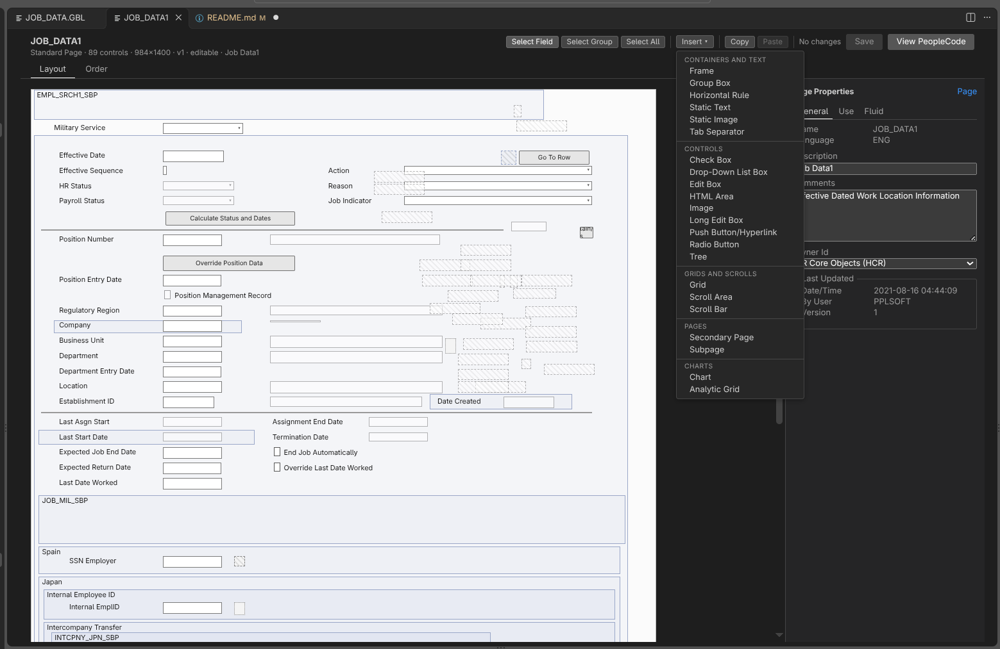
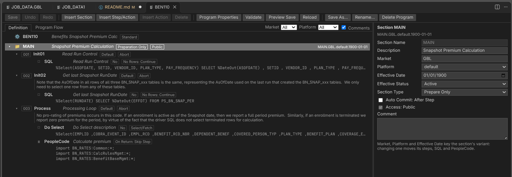
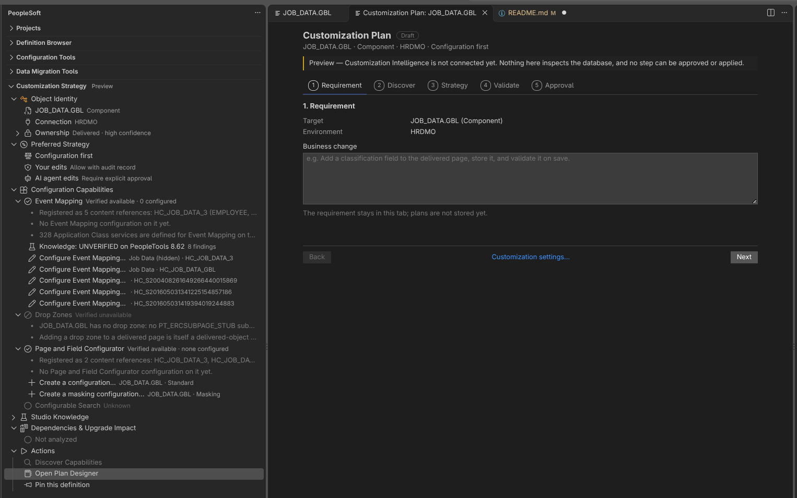

# PeopleSoft Studio

**PeopleSoft development in VS Code.** Open, edit and save PeopleCode, records,
pages, components, App Engine programs and the rest of Application Designer's
definitions, and let AI agents work on them through a built-in MCP server.

PeopleSoft Studio connects to a PeopleSoft database (Oracle; SQL Server and DB2
experimental) or opens an Application Designer project export. Every connection
is read-only until you make it writable; then definitions are saved natively,
writing the same rows Application Designer writes.

> **Status:** under active development, with new builds every few days. Saving
> is experimental: read the [Disclaimer](#disclaimer) before writing to any
> database.

Current release: **0.9.3** (PeopleTools 8.61 fixes); see the
[changelog](CHANGELOG.md) (0.9.1: [release verification](docs/RELEASE_0_9_1.md)).

## Why PeopleSoft Studio

- **Your definitions, in the editor you already use.** PeopleCode with
  completion, hover and outline. App Designer's record, field, page, component,
  menu, Component Interface, App Engine and message channel windows, rebuilt as
  VS Code editors. SQL, HTML and style sheets as plain text.
- **Saves Application Designer recognizes.** Writers use captured native
  saves on HRDMO (PeopleTools database release 8.62.09), with tests that replay
  those captures. Supported writes are checked by native reopen and readback;
  unsupported changes are refused.
- **A PeopleCode compiler checked at scale.** Recorded corpus comparisons
  reproduced stored bytecode for 30,205 of 30,209 HCDEV programs, and matched
  PeopleTools 8.62.09's binary and name rows for all 30,067 programs compared
  on HRDMO. These results cover captured programs, not arbitrary new code;
  see [compiler evidence](docs/CONTROLLED_COMPILE_LAB.md).
- **Built for AI agents.** A local MCP server gives Claude Code, Codex or any
  MCP client supported reads and writes through the editors' providers and
  writers, each write approved by
  you in VS Code by default.
- **Safe by default.** Read-only connections, separate delivered-object
  policies for user and agent writes, an audit log, and a
  PeopleCode save reports of the rows replaced.
- **Knows what is yours.** Every definition is classified Delivered, Delivered
  modified, Partner, Custom or Unknown, with its evidence. Verified Studio
  creations retain ownership receipts. Event Mapping, Drop Zones and Page
  and Field Configurator are discovered and configured through the
  Customization Strategy view.


**Page Designer:**


**App Engine Designer:**


**Customization Orchestration:**



## AI agents

PeopleSoft Studio runs its own local MCP server. Claude Code, Codex and other
Streamable HTTP MCP clients use the same tools, which read and write through
Studio's database providers. Integration with Oracle's delivered PeopleTools
8.63 MCP is planned; this release uses Studio's implementation.

```text
AI client -> local PeopleSoft Studio MCP -> database provider -> PeopleTools tables
```

## Disclaimer

**PeopleSoft Studio is provided "as is", without warranty of any kind**, express
or implied (see [LICENSE](LICENSE)). There is **no guarantee** that what it reads,
decodes, compiles or writes is correct, complete or fit for any purpose. You use
it at your own risk; the authors are not liable for data loss, corrupted
definitions, outages or any other damage.

- **Not an Oracle product.** PeopleSoft Studio is independent: it is not
  affiliated with, endorsed or supported by Oracle. PeopleSoft and PeopleTools
  are trademarks of Oracle.
- **Saving is experimental.** PeopleSoft Studio writes directly to PeopleTools
  tables -- for PeopleCode `PSPCMTXT`, `PSPCMPROG`, `PSPCMNAME`; for records,
  fields, pages, components and the other definitions their own tables; and
  `PSVERSION` / `PSLOCK` -- using an independently developed compiler and save
  routines, not Oracle's. Save protocols are calibrated from native saves on
  HRDMO (database release 8.62.09). Other PeopleTools releases, patches and
  configurations may behave differently.
- **Compiling with Application Designer is still recommended.** After saving
  PeopleCode from VS Code, open the program in Application Designer and save
  (compile) it there, so PeopleTools' own compiler validates it. Do this
  especially before migrating it to another environment.
- **Make a connection writable only where you can recover.** Connections are
  read-only by default. Allow writes only on development or lab databases you
  have backups of, and follow your organization's change-control process. Each
  save keeps a report of the rows it replaced, but that is not a backup.

## Get Started

1. Install **PeopleSoft Studio**.
2. Reload VS Code. Open the VS Code Command Palette ( CTRL + SHIFT + P ):
   ```text
   Developer: Reload Window
   ```
3. Add and connect to a PeopleSoft environment from the **PeopleSoft Studio** sidebar.
4. Verify that the MCP server is running: in the **PeopleSoft Studio**
   sidebar, the **Settings** panel shows **MCP server** below the compiler
   profile, green while it is running.
5. Connect an AI client using **PeopleSoft → Settings → Configure AI Client…**.

   Choose your client:

   - **Claude Code**: registers the server for all your local projects.
     The same as running:
     ```bash
     claude mcp add --transport http --scope user peoplesoftStudio http://127.0.0.1:7337/mcp
     ```
   - **Codex** (CLI / IDE): the same as running:
     ```bash
     codex mcp add peoplesoftStudio --url http://127.0.0.1:7337/mcp
     ```
   - **Any other MCP client**: choose **Copy MCP URL** and add it to the
     client as a Streamable HTTP server named `peoplesoftStudio`.
     **Manual Setup** shows the commands above to copy.

   The URL uses the port in the `peoplesoft.mcp.port` setting (7337 by
   default). Restart or reload the client if it was already running.

## What works now

Goal long-term: replace Application Designer. **Today it reads many common definition types and edits the supported kinds below** -- PeopleCode, records, fields, pages, components, App Engine, menus, Component Interfaces, message channels, SQL, HTML, style sheets, translates, projects and a bounded PS Query workflow. Saving is experimental. The tables distinguish working editors from read-only viewers and features still planned.

In **0.9.2**, File Layouts open in a File Layout Designer and save as App
Designer saves them; Build Requests turn attached documents into a reviewed
spec and a build; projects carry the related definitions their members need
(sections, SQL, PeopleCode, translate values, Message Catalog entries, content
references and their folders); and PeopleCode, SQL and App Engine saves are
checked against run-time failures App Designer does not catch (see
[docs/PEOPLECODE_RULES.md](docs/PEOPLECODE_RULES.md)).

In **0.9.0**, Configuration Tools includes working Process Definition,
Page and Field Configurator, Drop Zone and bounded OAuth editors. The MCP adds
a structured capability catalog, Process Definition editing, and bounded PS
Query authoring/execution. Query and Process Definition ownership uses the native
keys and preserves delivered-object policy checks. Eleven live HRDMO MCP checks
verified previews, guarded Query saves and readback. See
[MCP workflows and validation](docs/MCP_REFERENCE.md),
[Process Definitions](docs/PROCESS_DEFINITIONS.md),
[Customization](docs/CUSTOMIZATION.md) and [Security](docs/SECURITY.md).

Integration Broker, administration and Portal Registry authoring remain
available. Studio migration packages cover supported fields, basic records and
App Engine with dependency review, target preview and verified save receipts;
MCP exposes review/export/preview, with apply in the UI. See
[Project migration](docs/PROJECT_MIGRATION.md) for scope and limits.

### Definition types (App Designer's Open Definition)

Every type in App Designer's **Open Definition** list, and where it stands.
**Yes** = read and create/save; **Experimental** = edited and saved,
reproducing App Designer's saves; **Read-only** = viewer, from the database;
**Not yet** = no viewer or editor.

| Definition type | Status | Notes |
|-----------------|--------|-------|
| Application Package | Yes | Browse; create packages and classes; Application Class PeopleCode reads and saves; properties read-only |
| Field | Yes | Editor: length, labels and description; create. MCP additionally sets Character format to Uppercase or Mixed Case |
| HTML | Yes | Read, create and save — see [docs/HTML_SAVE.md](docs/HTML_SAVE.md) |
| Project | Yes | Browse, open XML exports, create and add supported members, including AE sections and AE PeopleCode. Studio migration packages support fields, basic records and App Engine; unsupported adapters are reported |
| Record | Yes | Editor (Field / Use / Edits); editable; create; translate values; delete — see [docs/RECORD_SAVE.md](docs/RECORD_SAVE.md) |
| SQL | Yes | Read, create and save |
| Style Sheet | Yes | Freeform: read as CSS, create and save — see [docs/STYLESHEET_SAVE.md](docs/STYLESHEET_SAVE.md). Classic / sub: a read-only class list |
| App Engine Program | Experimental | App Engine Designer: create, edit, save, copy, rename, delete, as App Designer does — see [docs/APP_ENGINE.md](docs/APP_ENGINE.md) |
| Component | Experimental | Structure, properties, page rows and Component PeopleCode, saved as App Designer saves — see [docs/COMPONENTS.md](docs/COMPONENTS.md) |
| Component Interface | Experimental | CI Designer: create on a component (properties defaulted or not, as App Designer asks), edit, save, Save As, rename, delete as App Designer does — keys, properties and collections dragged from the component's buffer, Edit Property, Read Only, standard methods, synchronization, Methods PeopleCode; see [docs/COMPONENT_INTERFACES.md](docs/COMPONENT_INTERFACES.md) |
| File Layout | Experimental | File Layout Designer — see [docs/FILE_LAYOUTS.md](docs/FILE_LAYOUTS.md) |
| Menu | Experimental | Menu Designer: create (Standard or Popup), edit, save, Save As, rename, delete as App Designer does — bars, items (component, PeopleCode with ItemSelected, separator, transfer), Menu Properties; see [docs/MENUS.md](docs/MENUS.md) |
| Message | Experimental | Integration Broker inspection and bounded nonrowset message creation/editing — see [docs/INTEGRATION_BROKER.md](docs/INTEGRATION_BROKER.md) |
| Message Channel | Experimental | Message Channel window: create, edit, save, Save As, rename, delete as App Designer does — Message Channel Properties, the messages on the channel, partition fields as App Designer lists them; see [docs/MESSAGE_CHANNELS.md](docs/MESSAGE_CHANNELS.md) |
| Page | Experimental | Visual Layout editor with a property panel for every control type, saved as App Designer saves — see [docs/PAGE_SAVE.md](docs/PAGE_SAVE.md) |
| Page (Fluid) | Experimental | The same editor; **New Page Fluid** creates one from a Layout Page |
| Image | Read-only | Shown in a panel (GIF, PNG, JPEG, SVG, BMP) |
| Activity | Not yet | Identified in project exports; no viewer yet |
| Analytic Model | Not yet | Identified in project exports; no viewer yet |
| Analytic Type | Not yet | — |
| Approval Rule Set | Not yet | — |
| Business Interlink | Not yet | — |
| Business Process | Not yet | Identified in project exports; no viewer yet |
| File Reference | Not yet | — |
| Optimization Model | Not yet | Identified in project exports; no viewer yet |

### Capabilities

| Capability | Status | Notes |
|------------|--------|-------|
| Connect to Oracle (PeopleTools tables) | Yes | Schema per connection: set it, or detected from `PS.PSDBOWNER` (else `SYSADM`) |
| Field editor (App Designer's Field dialog) | Yes | Read-only; length, labels and description editable on Writable connections |
| **HTML definitions** as text | Yes | Create and save on Writable connections — see [docs/HTML_SAVE.md](docs/HTML_SAVE.md) |
| Insert a definition into a project | Yes | Writable connections, through the UI or MCP `psft_add_to_project`. Adds what the members need with them (App Engine sections, SQL and PeopleCode; component and page PeopleCode; translate values; custom SQL objects; Message Catalog entries; content references and their custom folders); `psft_project_related` lists what a project still lacks — see [docs/MCP_0_8_8.md](docs/MCP_0_8_8.md) and [docs/PROJECT_INSERT.md](docs/PROJECT_INSERT.md) |
| MCP server (AI clients) | Yes | Search/read supported definitions and bounded PeopleCode text search; `psft_list_definition_types` gives type codes and key parts. Experimental authoring tools cover PeopleCode, SQL, HTML, style sheets, pages, records, fields, translates, projects, packages, App Engine, menus, Component Interfaces, message channels, Portal Registry folders/content references, Message Catalog, HCM Text Catalog and URL definitions. 0.9.0 adds product orientation and a structured capability catalog, Process Definition editing, and bounded PS Query search/read/prepare/run/create/edit/copy. Integration Broker authoring and project migration review/export/preview remain available; imports apply through the UI. Structured designers and tools share their models and writers, with validation and concurrency checks. Customization tools cover ownership, Event Mapping, Drop Zones and Page and Field Configurator; discovery tools read and record evidence. Version 0.9.1 stages supported Oracle writes in Change Review for exact-revision approval and verified application. Other paths retain their existing modal/policy gates; adapter coverage is bounded. See [docs/MCP_WRITES.md](docs/MCP_WRITES.md) and [0.8.8 fixes](docs/MCP_0_8_8.md) |
| **New Definition...** (Projects / Definition Browser) | Yes | Records (SQL Table, Derived/Work), fields, components, projects, Application Packages and classes, SQL, HTML, freeform style sheets, on Writable connections — see [docs/CREATE_DEFINITIONS.md](docs/CREATE_DEFINITIONS.md) |
| Open App Designer XML project export | Yes | |
| Open Definition search | Yes | |
| **PeopleCode** as text (`psft://…`) | Yes | On Writable connections, supported Record Field, Component, Page, Menu, App Engine, Component Interface and Application Class programs open as stored source (`PSPCMTXT`) and can be saved. Unsupported programs and Read-only connections open read-only, decoded from `PSPCMPROG`; exports use their stored source |
| PeopleCode IntelliSense-lite | Yes | Completion, hover, outline, snippets |
| PeopleCode syntax highlighting | Yes | |
| Project tree & definition browser | Yes | |
| Record editor (App Designer's Field / Use / Edits displays, Record Type) | Yes | Read-only, editable on Writable connections — see [docs/RECORD_SAVE.md](docs/RECORD_SAVE.md) |
| Record → field → PeopleCode event navigation | Yes | |
| Settings panel | Yes | *PeopleSoft: Open Settings* — connections, compiler profile, MCP server, Build Settings (Build and Alter tabs) |
| **SQL definitions** as text | Yes | Create and save on Writable connections, as App Designer saves them. **Run SQL** runs a query (the selection, or the whole editor) read only and rolled back, and shows the rows beside it: one SELECT, no `INTO` or `FOR UPDATE`, `%Table(record)` expanded, other meta-SQL and binds refused, at most `peoplesoft.sql.maxRows` rows |
| **Style sheets** | Yes | Freeform: read as CSS, create and save on Writable connections — see [docs/STYLESHEET_SAVE.md](docs/STYLESHEET_SAVE.md). Classic / sub: a read-only class list |
| Translate values; Delete Record | Yes | Writable connections — see [docs/RECORD_SAVE.md](docs/RECORD_SAVE.md) |
| **App Engine programs** (App Engine Designer) | Experimental | App Designer's App Engine window: the **Definition** view (sections and their market / platform / effective-date variants, steps, actions) and **Program Flow**, with a property panel for the program (General, State Records, Temp Tables, Advanced), each section, step and action. On Writable connections: Insert Section / Step/Action / Action, change an action's type, rename, move, Cut / Copy / Paste, delete, every property App Designer stores, SQL, XSLT and PeopleCode in VS Code editors, undo / redo, validation (App Designer's Edit Validation plus references and PeopleCode compiled), Preview Save, and *New Definition > App Engine Program* — saved as App Designer saves it (85 of 88 captured App Designer saves replay row for row; the rest differ only where App Designer leaves a hash row stale). See [docs/APP_ENGINE.md](docs/APP_ENGINE.md) and [docs/APP_ENGINE_SEMANTICS.md](docs/APP_ENGINE_SEMANTICS.md) |
| **Build...** (SQL Tables) | Experimental | Create Tables as a script, or build and execute on Writable connections. Alter Tables, Create Indexes alone and views not yet. **Build Project**: one Create Tables script for a project's SQL Tables (script only; views, Derived/Work and records with subrecords are listed as left out) |
| **Component Interfaces** | Experimental | CI Designer and MCP tools: create, edit, save, copy, rename and delete; keys, properties, collections, standard methods, synchronization and Methods PeopleCode — see [docs/COMPONENT_INTERFACES.md](docs/COMPONENT_INTERFACES.md) |
| **Components** | Experimental | App Designer's component window: the **Definition** grid (View Definition on a page row), the **Structure** tab (the component buffer: search record, scroll levels and their records) and **Component Properties** (General, Use, Internet, Fluid, Style). On Writable connections all of it is edited and saved as App Designer saves it: page rows (labels, Hidden, order, Cut/Copy/Paste/Delete, Insert Page), every General, Use, Internet, Fluid and Style setting App Designer stores, never without a search record; *New Definition > Component* creates one. **Component PeopleCode** editor: View PeopleCode opens the component's (or a record's) first event, with App Designer's Object and Event pickers; an event with no program opens empty and saving creates it — see [docs/COMPONENTS.md](docs/COMPONENTS.md) |
| Connect to **Microsoft SQL Server** or **DB2** (LUW, z/OS) | Experimental | Everything above and below that reads, as on Oracle; writes are the same rows Oracle's App Designer captures proved, not yet captured on these platforms. DB2 needs *PeopleSoft: Install DB2 Driver*. Two-tier (App Designer 2 Tier) sign-on too. See [docs/DATABASES.md](docs/DATABASES.md) |
| **Customization Strategy** view and **Customization Plan** editor | Experimental / Preview | The Strategy view follows the open definition and discovers Event Mapping, Drop Zones and Page and Field Configurator. Its configuration actions write the supported settings, including custom subpages and Standard/Masking field configurations. Other frameworks remain Unknown. The Plan editor previews Requirement, Discover, Strategy, Validate and Approval with its actions disabled — see [docs/CUSTOMIZATION.md](docs/CUSTOMIZATION.md) |
| **Customization: ownership and the delivered-object policy** | Experimental | Delivered / Delivered modified / Partner / Custom / Unknown, with evidence from save stamps, projects, naming prefixes, delivered baselines and verified Studio creation receipts. Policies (block / requireApproval / allowWithAudit) apply to guarded definition saves, renames and deletes. User default: allow with audit; agent default: require approval for delivered, partner or Unknown definitions. New verified custom definitions retain their receipts across supported edits. MCP approval waits expire after 60 seconds or cancellation — see [docs/CUSTOMIZATION.md](docs/CUSTOMIZATION.md) |
| **Event Mapping** editor | Experimental | Configuration Tools > Customization > Event Mapping, or a component's content reference in the Customization Strategy view: the Configure Event Mapping page's configurations -- component, page, record and field level rows, their services, sequence and enabled flag -- and a new related content service with its application class, saved as PeopleTools' own page saves them, on Writable connections — see [docs/CUSTOMIZATION.md](docs/CUSTOMIZATION.md) |
| **File Layouts** | Experimental | File Layout Designer: create, edit, save, Save As, rename and delete; segments, fields, record insert and properties, saved as App Designer saves them — see [docs/FILE_LAYOUTS.md](docs/FILE_LAYOUTS.md) |
| **Integration Broker** | Experimental | Messages, Document Builder, services, service operations, nodes and routings: search, inspect, validate, create, preview and save through editors or MCP on PeopleTools 8.62.09 (on 8.61.15: nonrowset messages, standard services and operations, flat string documents); unsupported structures require PIA — see [docs/INTEGRATION_BROKER.md](docs/INTEGRATION_BROKER.md) |
| **Menus** | Experimental | The Menu Designer — see [docs/MENUS.md](docs/MENUS.md) |
| **Message Catalog**, **HCM Text Catalog**, **URL Definitions** | Experimental | Search, create and edit through Configuration Tools > Administration or MCP; typed schemas, catalog reference, Text Catalog configuration/language choices, concurrency and write gates — see [docs/ADMINISTRATION.md](docs/ADMINISTRATION.md) |
| **Message Channels** | Experimental | App Designer's Message Channel window — see [docs/MESSAGE_CHANNELS.md](docs/MESSAGE_CHANNELS.md) |
| **Pages** (Page designer) | Experimental | App Designer's visual **Layout** view and Order grid. Every control type has its own App Designer property panel (Record / Label / Use / General / Fluid / Image / Options tabs as they apply). On Writable connections: move, resize, delete, relabel, select/group, Copy / Paste, set tab Order, insert controls (Frame, Group Box, Horizontal Rule, Static Text, Static Image, Check Box, Drop Down, Edit Box, Long Edit Box, Radio Button, HTML Area, Push Button), edit each control's captured properties (label, style, use bits, on/off values, record rebind, Allow Deferred Processing, grid/scroll Occurs Count and grid display flags, Page Field Name, anchor, Fluid), Page Properties (General / Use / Fluid), Custom page size, **New Page / New Page Fluid**, and **Page PeopleCode** — all saved as App Designer saves it. See [docs/PAGES_COMPONENTS_MENUS.md](docs/PAGES_COMPONENTS_MENUS.md) and [docs/PAGE_SAVE.md](docs/PAGE_SAVE.md) |
| **Portal Registry** | Experimental | Select a portal, browse its Structure & Content tree, create folders and component/external content references, and edit properties, parent, sequence and security through the UI or MCP — see [docs/PORTAL_REGISTRY.md](docs/PORTAL_REGISTRY.md) |
| **Process Definitions** | View / Edit (Oracle) | Tabbed editor and MCP read/edit/rollback preview for scheduling defaults, overrides, output, recovery, components and process groups; no process scheduling or execution — see [docs/PROCESS_DEFINITIONS.md](docs/PROCESS_DEFINITIONS.md) |
| **Queries** (Windows PS Query workflow) | Experimental | **Open PS Query** / **New PS Query**, also Configuration Tools > PS Query. Oracle / PeopleTools 8.62.09 and 8.61.15: open existing public or own private queries; create, edit, save and Save As for one SQL Table record with direct character fields and at most one equal-to constant/prompt criterion. Headings, ordering, prompts, SQL and bounded read-only results with Query access checks. MCP exposes matching bounded read/prepare/run/create/edit/copy workflows. Unsupported shapes remain readable, with a reason saving/running is refused — see [docs/PS_QUERY_WINDOWS.md](docs/PS_QUERY_WINDOWS.md) |
| **Saving PeopleCode** | Experimental | Writable connections: compile and save, create an event or class that has no program yet, clear a program to delete it — see [Saving PeopleCode](#saving-peoplecode-experimental) |
| **Configuration Tools** and **Data Migration Tools** panes | Partial | **PS Query**, **Process Definitions**, **Page and Field Configurator**, **Event Mapping** and **Drop Zones** open working editors. Customization Strategy also exposes configuration actions. Administration opens Message Catalog, Text Catalog and URL editors; Portal Registry opens a portal picker and editable Structure & Content tree. Integration Broker opens six searchable editors with New, Preview and Save. Security opens OAuth configuration and legacy inbound SAML inspection. Data Mover Scripts creates script templates, and Import Migration Package opens the existing guarded UI workflow; Data Migration Workbench remains *Coming soon* |
| **OAuth / SAML** | Partial | OAuth applications: public configuration, audiences and role inspection; calibrated edits for existing CUSTOM / Client Only / Client Credentials applications on Oracle 8.62.09. Legacy inbound SAML mappings are read-only; 8.63 browser SAML SSO remains planned. Secrets and tokens are excluded — see [Security tools](docs/SECURITY.md) |
| **Discoveries** (Discovery Center) and Studio Knowledge | Preview | Findings about how PeopleSoft stores and saves definitions, each with its evidence and the PeopleTools releases it was seen on; the Customization Strategy view's *Studio Knowledge* shows those about the open definition's kind. Nothing is uploaded unless you turn submissions on and approve each one — see [docs/intelligence](docs/intelligence/README.md) |
| Definition **Properties** (packages, records, fields, components, pages, projects, menus, message channels, App Engine, SQL, HTML, style sheets) | Read-Only | A panel, from the database. Records, fields, pages and components are changed in their editors; HTML and freeform style sheet descriptions with *Change Description...* |
| **Images** | Read-Only | Shown in a panel (GIF, PNG, JPEG, SVG, BMP) — see [docs/IMAGES.md](docs/IMAGES.md) |
| **Permission Lists**, **Roles** | Read-Only | A permission list's pages and actions, sign-on times, Web Libraries and more; a role's permission lists — see [docs/SECURITY_MESSAGES.md](docs/SECURITY_MESSAGES.md) |
| **Trees** | Read-Only | Settings, levels, and nodes as an outline with detail ranges — see [docs/TREES.md](docs/TREES.md) |
| **XSLT** | Read-Only | Stylesheet text; node editing is covered by Integration Broker and node passwords are never shown — see [docs/URLS_NODES.md](docs/URLS_NODES.md) |

## What does **not** work yet

- Migration adapters for the remaining definition families (Studio packages currently cover fields, basic records and App Engine)
- Editing record shapes and settings no App Designer save has been captured for (see [docs/RECORD_SAVE.md](docs/RECORD_SAVE.md))
- Register Menu Item (portal registration) and menu translations
- Component Interfaces: Test Component Interface, Java / C templates, CI references
- Running App Engine programs (the designer and the MCP read, write and validate definitions; they never run them)
- In the component editor: Default Search Action, the search-page link message numbers, the Custom style lists; component edits through the MCP
- Build beyond SQL Tables (Alter Tables, indexes alone, views); migration of definition families outside the supported Studio package adapters
- Full language server and compile diagnostics as you type. F12 already resolves supported definition references, application class paths and declared PeopleCode functions in the connected environment; *Validate PeopleCode* checks on demand.
- Full PS Query parity: joins, unions, subqueries, grouped/effective-date criteria, expression columns, numeric/date fields, aggregates, translate SQL, DISTINCT and row-security SQL are not yet editable/executable. Query rename, delete, Excel export and printing are also planned.

See [docs/ROADMAP.md](docs/ROADMAP.md) for the longer path.

## Two backends

**Database** — live PeopleTools tables (Oracle; SQL Server and DB2 experimental). Full environment search; PeopleCode is decoded from the tokenized `PSPCMPROG` byte stream.

**Project export** — App Designer XML on disk. No DB credentials; PeopleCode is the plain source App Designer already wrote. Scope is that project only.

A backend is where definitions come from. The two front ends — the VS Code UI
and the [MCP server](docs/MCP_REFERENCE.md) for AI clients — sit on top of both:

```text
   VS Code UI          MCP server (AI clients)      <- front ends
        \                    /
         DefinitionProvider interface
        /                    \
 Database backend      Project export backend       <- backends
```

Both front ends talk only to the `DefinitionProvider` interface, through the
same readers and writers. Capabilities (write, global search, build) are
declared per backend, so an AI client gets exactly what the editors get, and a
fix to a reader or writer reaches both.

## PeopleCode storage

Oracle does not document the on-disk format. Programs are a tokenized stream in `PSPCMPROG.PROGTXT` (chunked by `PROGSEQ`) with identifiers in `PSPCMNAME`.

This extension decodes that stream with a conservative opcode table: **unknown bytes are reported, never guessed**.

Settings:

- `peoplesoft.peoplecode.decoder`: `auto` (default) | `strict` | `raw`, the
  default for connections that do not set their own decoder (per connection, in
  Settings). Use `raw` when extending the decoder against real programs.

## Saving PeopleCode (experimental)

Read the [Disclaimer](#disclaimer) first. Every connection is **read-only** until
you change it. To allow saves on a connection, open *PeopleSoft: Open Settings*
and, in that connection's **PeopleCode saving** group:

1. Set **Operator ID** to a PeopleSoft operator that exists in that database
   (it is checked against `PSOPRDEFN`). Saves are recorded under it.
2. Set **Access** to **Writable** and confirm.
3. Leave **Save mode** at **Compile and save**.

Then open a program -- record → field → event in the tree, an Application
Class, or *View PeopleCode* on a component -- edit it, and save. An event or
class that has no program yet opens empty and the first save creates it;
clearing a program and saving deletes it. A save is refused with the reason
when:

- the program changed since you opened it;
- the edit does not compile;
- the stored program is not one the writer reproduces exactly;
- the operator does not exist in that database.

Saving covers Record Field PeopleCode, Component PeopleCode (component,
component record and component record field), Page Activate, Menu ItemSelected,
App Engine OnExecute, Component Interface Methods and Application Classes, for
any definition name unless `peoplesoft.writeNamePrefix` limits it. Afterwards,
compile the program in Application Designer as well (see the Disclaimer). See
[CHANGELOG.md](CHANGELOG.md) for details.

## Editor features (PeopleCode)

- **Go to Definition** — F12 / Ctrl-click resolves qualified application class paths, supported `Record.NAME` / `Page.NAME` and other definition references, and functions declared against Record PeopleCode. The target must exist in the connected environment.
- **Completion** — keywords, common built-ins, system variables, locals in the file, `Function` / `method` names
- **Hover** — short docs for keywords, built-ins, `%` system variables
- **Outline** — class / method / function / property symbols
- **Snippets** — `if`, `for`, `try`, `locs`, `msgbox`, `sqlexec`, …
- **Validate PeopleCode** — compiles the program in the editor with PeopleSoft Studio's compiler (the one saves use) for the connection's PeopleTools release, and shows where it stops in Problems; Application Designer has the last word
- **Find References** — where an identifier (a whole word) or any text occurs in every PeopleCode program of the connection, from the word at the cursor; on a database one search of the stored source, so every program is covered. Pick an occurrence to open it at that line
- **Compare Project** (Projects view) — text and modeled record/field metadata compared with another connection. Read failures remain errors; missing definitions require a successful absence check. Differences open as snapshots side by side.
- **Administration tools** — Message Catalog, HCM Text Catalog and URL Definitions have searchable editors with create/edit, concurrency checks and readback verification. See [Administration](docs/ADMINISTRATION.md).
- **Export Migration Package... / Import Migration Package...** — versioned Studio JSON packages, target preview, guarded writers, readback verification and a migration receipt. Fields, basic records and App Engine are supported.
- **Review Project Migration...** (Projects view or command palette) — a saveable report of members, optional target comparison, explicit dependencies, and unresolved coverage. On Writable database connections, select dependencies to include through the existing project writer. Export/import uses Studio migration packages without Application Designer. See [Project migration](docs/PROJECT_MIGRATION.md).
- **Compare With Environment** — a definition side by side with the same one in another connection (a database or a project export), in VS Code's diff editor. The other side is read once, without making that connection the active one

SQL documents use language id `psft-sql` (basic highlighting). HTML definitions open as HTML; *Preview HTML* shows one as a page, with no script run and nothing fetched.

## Setup

1. Install the VSIX (`npm run dev` from a clone, or install a release build).
2. Open the **PeopleSoft** activity bar icon.
3. **Add Connection** (Oracle, SQL Server or DB2) or **Open Project Export File**.
4. Connect, then **Open Definition…** or use the project tree.

Oracle Instant Client is optional (`peoplesoft.oracle.thickModeLibDir`); leave empty for node-oracledb Thin mode.

The PeopleTools tables are read in the connection's **Schema** (Settings →
the connection → Edit). Left empty, it is the database's owner ID from
`PS.PSDBOWNER`, else `SYSADM`. Set it when the owner ID differs and the
access id is not the owner; the access id then needs grants on that
schema's PeopleTools tables. Connect fails with a clear message when the
schema has no PeopleTools tables.

Saving and creating definitions can be limited to names starting with a
prefix with `peoplesoft.writeNamePrefix` (empty: no limit).

## Coexisting with other PeopleSoft extensions

`jatz.peoplesoft-tools` contributes a language also called `peoplecode`, on
scope `source.peoplecode`, claiming `.pcode` and `.ppl`. Two grammars on one
scope means load order decides which wins.

So this extension uses `psft-peoplecode` on `source.psft.peoplecode`, and its
virtual documents end in `.peoplecode` rather than `.pcode`. Both extensions can
be installed together. `richardwood.peoplesoft-datamover` only claims `.dms` and
`.dmt`, so it does not overlap at all.


## Troubleshooting

1. Check that the MCP server is running: the **Settings** panel's **MCP
   server** row is green. If it is not, run *PeopleSoft: Start MCP Server*.
2. Check that your client has the server registered as `peoplesoftStudio`:
   ```bash
   claude mcp list    # Claude Code
   codex mcp list     # Codex
   ```
   For another client, check that its MCP settings hold the URL from
   *Copy MCP URL*.
3. Restart or reload the client if it was already running when you
   registered the server.


### Integration Broker

Messages, Document Builder, Services, Service Operations, Nodes and Routings now
have search, inspection, validation, New, Preview and Save tools. The MCP
explicitly distinguishes standard services, REST consumers and REST providers.
Use `psft_ib_reference` for the workflow and
[Integration Broker documentation](docs/INTEGRATION_BROKER.md) for supported native
write paths and current PIA-only boundaries. Writes are calibrated on PeopleTools
8.62.09; on 8.61.15, for nonrowset messages, standard services, standard
operations without handlers and flat string documents.

### MCP workflow discovery

Start with `psft_studio_reference` or the filterable `psft_capability_catalog`
for definition types, configuration tools, customization strategy and migration
coverage. Process Definition editing and bounded PS Query authoring/execution
now have dedicated MCP tools. See [MCP reference](docs/MCP_REFERENCE.md) for
inputs, operation limits, rollback previews and validation.

### Change Review development initiative

The 0.9.1 workflow adds durable Change Sets, persistent semantic review,
checkpoint/history and reviewed reversal for bounded MCP paths. It does not yet
cover every object type. Track
verified implementation and remaining native acceptance in
[Change Review progress](docs/change-review/PROGRESS.md).

The development UI provides **PeopleSoft → Change Review** for pending changes
and history. Object actions live on right-click menus; project migration actions
live on the selected project. View headers keep at most two frequent actions,
with secondary operations in their overflow menus. Approval and application
remain inside the review workspace. See [navigation and action placement](docs/NAVIGATION.md).
